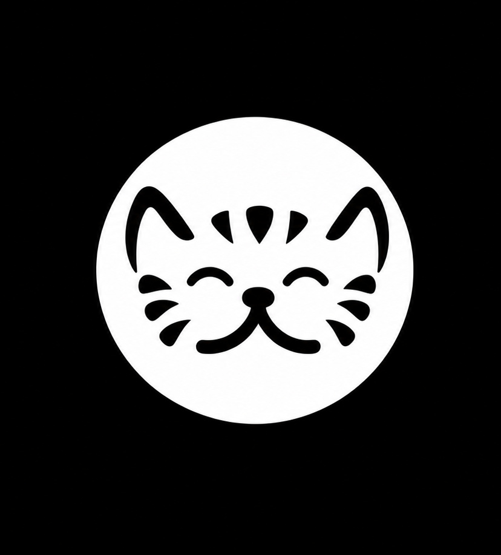

<p align="center">
  
</p>

# Cat Browser

A personal, experimental fork of WebLibre. An Android browser built on Mozilla's Gecko engine, with containers, isolated tabs, Tor and proxy routing, Firefox extensions, and local search. This fork takes the original in directions that do not fit upstream, so expect rough edges and breaking changes.

Cat Browser is not affiliated with the WebLibre project. WebLibre remains the upstream and is the right choice if you want a stable, maintained browser. This repo exists because I wanted to experiment freely.

## Why it differs from WebLibre

WebLibre is a polished, general-purpose browser. Cat Browser is a sandbox for ideas that are too opinionated or unfinished for upstream:

- A redesigned home page with a clock and rotating wallpaper instead of the brand mark.
- Privacy X-Ray: a per-tab badge and sheet showing blocked trackers and categories.
- Tab snoozing, Link Peek, and other experiments land here first.
- UI and branding changes that would not be accepted upstream.

Some changes will be random in direction. Nothing here is guaranteed to be stable or to ship upstream. Treat releases as experimental.

## What is included

- Containers with per-container cookie isolation and Tor or proxy routing.
- Isolated tabs that keep their session and survive restarts.
- Tree-style tab management with pinning, stacking, and filtering.
- Built-in Tor and a multi-protocol proxy client (SOCKS, HTTP, WireGuard, Shadowsocks, and more).
- Firefox-compatible extensions, including uBlock Origin during onboarding.
- Local search across tabs, bookmarks, history, and feeds, with optional on-device indexing.
- On-device AI helpers, page translation, reader mode, and RSS feeds.
- Firefox Sync for tabs, bookmarks, and history.

## Requirements

- Android 8.0 or newer. Android 13 or newer is recommended.
- Built from source. No prebuilt releases are provided.

## Build from source

You need Android SDK 37.1 and JDK 17. Point `JAVA_HOME` at your JDK 17 install.

```
./gradlew testFullDebugUnitTest lintFullDebug assembleFullDebug
```

The debug APK installs as `dev.sk2andy.materialbrowser.linkpeek` only in the upstream; here it installs under the standard application id. Adjust the gradle command for your flavor (`full`, `foss`, `systemwebview`).

For a signed release build, create a keystore and configure `keystore.properties` (see `keystore.properties.example`). Never commit the keystore.

## Project layout

```
apps/weblibre/        Flutter app
packages/             Shared Flutter packages
native/               Native helpers
scripts/              Build and asset scripts
```

## License

Cat Browser is free software under the [GNU Affero General Public License v3.0](COPYING).

WebLibre, which this fork is based on, is also AGPL-3.0. Cat Browser keeps the same license. Please keep attribution to the original project when redistributing.